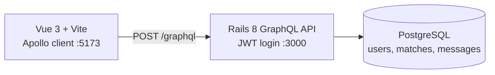
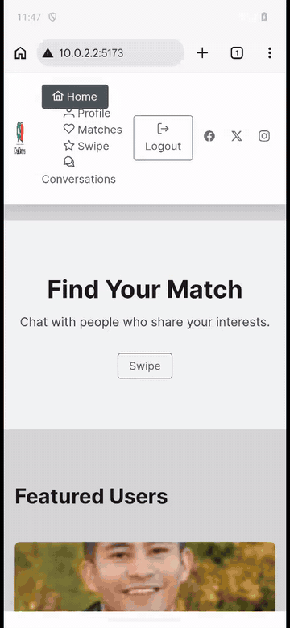

# ChatDaters

[](https://github.com/Exalt24/ChatDaters/actions/workflows/ci.yml)

A swipe, match and message app: a Rails GraphQL API and a Vue 3 frontend, built solo in a three day internship sprint.


*Recorded from the real app running on a local stack (Rails API in Docker, Vue app on Vite).*

**Proof:** a fresh clone gets a running API with 14 seeded users in 126 seconds (`docker compose up --build -d`, measured 2026-10-17), and through that API a first like creates a `pending` match, the second turns it `matched`, and a message is stored. There is no hosted copy, so this local run is the demo.

Built during my Full Stack Developer internship at ChatGenie.PH (Techstars '23, July 2024). It is one of two apps I shipped solo there, each in a compressed three day sprint; the other is [ChatHotel](https://github.com/Exalt24/ChatHotel).

## What it does

- **Swipe deck:** profiles show as cards with like and pass buttons. The deck leaves out profiles you already liked or matched with, and keeps profiles that fit the current user's gender interest.
- **Mutual match:** the first like creates a `pending` match; when the other person likes back it becomes `matched` and the app says "You have matched with this user!".
- **Messaging:** the chat icon on a match opens a thread, and messages are stored in Postgres and served over GraphQL. Messages load when a page opens or refreshes; Action Cable is generated by Rails but no channel or subscription exists, so there is no live push.
- **Admin area:** a dashboard with user and match counts, plus a user list.

## Architecture



This is a monorepo merged from the two original repositories with their git history kept: `backend/` is the Rails API, `frontend/` is the Vue single page app, and `docker-compose.yml` runs the API and Postgres.

## Run it

You need Docker and Node 20.19 or newer. No Ruby install is needed. The seed downloads portraits from randomuser.me, so it needs internet access.

```bash
docker compose up --build -d
docker compose exec api bin/rails db:seed
cd frontend && npm install && npm run dev
```

The API listens on http://localhost:3000/graphql. To use another host port, set `API_PORT` (for example `API_PORT=4757 docker compose up --build -d`) and start the frontend with `VITE_GRAPHQL_URL=http://localhost:4757/graphql npm run dev`. Open the address Vite prints, http://localhost:5173.

Every seeded user has the password `password`. `user1@gmail.com` is a woman interested in men, `user2@gmail.com` is a man interested in women, and `admin1@gmail.com` opens the admin area. To see a match, log in as `user1@gmail.com` and like `user2@gmail.com`, then log in as `user2@gmail.com`, like her back, open Matches and tap the chat icon.

Sign-up works, but its activation email goes out through Gmail SMTP with credentials that are not in the repository, so locally it ends in an error at the email step; use the seeded accounts. The JWT signing key comes from the Rails credentials when they can be decrypted and otherwise from Rails' own `secret_key_base`, so no master key is needed.

## Automation lab



*Recorded from a live run on an Android emulator against this app with the seeded accounts.*

`automation/` drives this app through Appium in Chrome on an Android emulator: it swipes the deck by filters from one config file, types a templated first message to each new match, paces itself, stops at daily caps and writes a report with the reply rate of each template. Every command is a read only dry run unless `--live` is given, and it refuses any host that is not on the config's allowed list. It is for this app and its seeded accounts only: Tinder, Hinge, Bumble and Instagram all ban automation in their own terms, with the quotes in [docs/AUTOMATION.md](docs/AUTOMATION.md). Setup, the config, the safety defaults and the limits are in the same file.

What broke: the first live run failed on the first message of a new conversation with `Cannot access 'data' before initialization`, a bug in `frontend/src/views/User/Matches.vue` (the cache update read a value its own call was still producing). It is fixed, and the same run passes.

## Tests

- **Automation unit tests:** `python -m unittest discover -s automation/tests -v` runs 38 tests on the filters, templates, schedule, caps, report and the scheduled loop. `python automation/tests/mutation_check.py` breaks the rules in 21 small ways and requires the tests to turn red each time; all 21 are caught. Both run in CI.
- **End to end on the emulator:** `python automation/e2e_appium_chatdaters.py` resets the database, runs a dry run and two live runs in Chrome on the emulator and checks 12 results against the real records. It needs a device, so it does not run in CI. After the app fix it passed on seven of eight runs on 2026-10-25; the one failure was a race in the driver (it read a conversation before the thread had loaded), fixed, and the next two runs passed.
- **The rest of the app has no test suite.** The CI workflow in `.github/workflows/ci.yml` runs RuboCop, Brakeman, a schema load into Postgres and a Zeitwerk eager load for the API, and `npm ci` plus the Vite build for the frontend. On 2026-10-17 I ran the API half of Run it in a fresh clone (the stack, the seed, login for three accounts, the pending then matched sequence, and a stored message) and `npm install` plus `npm run build` for the frontend (it builds).

## Limits and not done

- **No authentication on the user list.** Whether a request needs a token is decided by the operation name the client sends. A request named `GetUsers` is treated as public, and an unauthenticated `users` query returned all 14 seeded users with email, mobile number and birthdate. Do not expose this API as it stands.
- **The match mutation does not check who liked.** The same user liking twice flips a `pending` match to `matched`; the only guard is the deck filter, which runs in the browser against the full user list.
- No live push for messages (see above), and no tests for the app itself beyond the automation lab's end to end run.
- Nothing is deployed. The old hosted copy is gone, and `backend/render.yaml` and the production settings are left over from that Render deploy and are not exercised locally.

## Stack

Ruby on Rails 8 (graphql-ruby, Active Storage, JWT), PostgreSQL, Docker, Vue 3, Vite, Tailwind CSS, PrimeVue, Apollo client.

## License

MIT, see [LICENSE](LICENSE).
